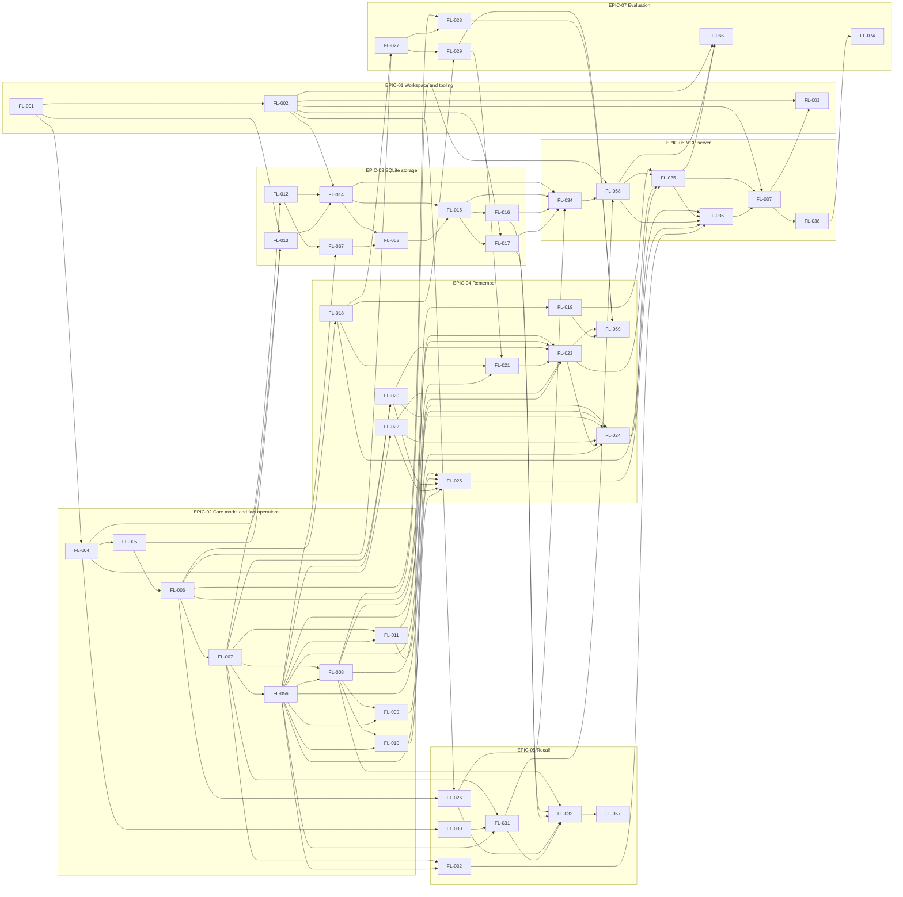
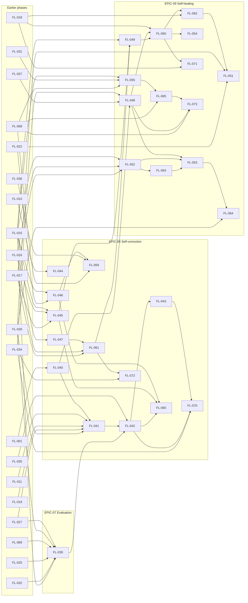

# Roadmap

The index of Factloom's delivery plan: its phases, epics and work items, their dependencies and their status. Details of each work item are in its epic file. How to read and maintain this index is in [`README.md`](README.md); the requirements it traces to are in [`docs/product/REQUIREMENTS.md`](../product/REQUIREMENTS.md).

**Status on 2026-11-14:** nothing is implemented. All 74 work items are `Pending`. There are no dates in this plan.

## Delivery phases

A phase is a capability that can be demonstrated on a real system, not a list of tasks. A work item may start as soon as its own prerequisites are complete, whichever phase it is in.

| Phase | Capability | Shown to be complete when | Work items |
|---|---|---|---|
| 0. Foundations and design proof | The workspace checks itself, the core model exists as types, and the "fact changed over time" scenarios exist as reviewed data. | `pnpm check` passes in continuous integration on Linux and macOS arm64 (FL-002). A forbidden import fails the check (FL-001). The storage contract suite passes against the in-memory store (FL-012, FL-067). The eleven timeline scenarios validate against their schema (FL-027). | 11 |
| 1. Product 1 for code | Claude Code and Codex save and recall project memory through the MCP server, from one SQLite file, with as-of and known-at questions answered correctly. | The smoke test records a fact, restarts the server and recalls it (FL-037). The storage contract suite passes against SQLite (FL-014 to FL-017, FL-068). Every extraction case passes in replay: each required fact is extracted and no forbidden one is (FL-069). The owner has registered the server with both hosts on an Apple Silicon Mac (FL-038). The performance targets in REQ-35 are met within their stated tolerance (FL-066). | 35 |
| 2. Self-correction | New information that conflicts with a stored fact is resolved, or proposed for approval, at write time. Feedback is recorded and acted on. Content can be purged. | On the timeline scenarios in replay, the staleness rate and the false invalidation rate are 0 (FL-042). After a purge, the content cannot be read through any read method or query of the database (FL-061). Under the human-approval policy a change waits as a proposal until a person approves it with a command (FL-070). | 14 |
| 3. Self-healing | A maintenance run verifies code facts against the repository without an LLM, merges duplicate entities, repairs anchors and archives unused facts. | On fixture repositories, with an LLM client that fails if called, a changed manifest version supersedes the stored fact (FL-062), and a deleted file or a missing function name flags it (FL-050, FL-071). A merge can be undone (FL-063). An archived fact is left out of recall and can be restored (FL-065, FL-073). | 14 |
| 4. Generic core, Postgres and HTTP API | See [EPIC-10](epics/EPIC-10.md) | Defined when the phase is near | Not yet written |
| 5. Document management | See [EPIC-11](epics/EPIC-11.md) | Defined when the phase is near | Not yet written |
| 6. Domain adapters | See [EPIC-12](epics/EPIC-12.md) | Defined when the phase is near | Not yet written |

## Epics

| Epic | Name | Phases | Work items | Status |
|---|---|---|---|---|
| [EPIC-01](epics/EPIC-01.md) | Workspace and tooling | 0-1 | 3 | Pending |
| [EPIC-02](epics/EPIC-02.md) | Core model and fact operations | 0-1 | 9 | Pending |
| [EPIC-03](epics/EPIC-03.md) | SQLite storage | 0-1 | 8 | Pending |
| [EPIC-04](epics/EPIC-04.md) | Remember | 0-1 | 9 | Pending |
| [EPIC-05](epics/EPIC-05.md) | Recall | 1 | 6 | Pending |
| [EPIC-06](epics/EPIC-06.md) | MCP server | 1 | 6 | Pending |
| [EPIC-07](epics/EPIC-07.md) | Evaluation | 0-2 | 6 | Pending |
| [EPIC-08](epics/EPIC-08.md) | Self-correction | 2 | 13 | Pending |
| [EPIC-09](epics/EPIC-09.md) | Self-healing | 3 | 14 | Pending |
| [EPIC-10](epics/EPIC-10.md) | Generic core, Postgres and HTTP API | 4 | Written when the phase is near | Pending |
| [EPIC-11](epics/EPIC-11.md) | Document management | 5 | Written when the phase is near | Pending |
| [EPIC-12](epics/EPIC-12.md) | Domain adapters | 6 | Written when the phase is near | Pending |

## Work items

### Phase 0: Foundations and design proof

| ID | Title | Epic | Depends on | Status |
|---|---|---|---|---|
| [FL-001](epics/EPIC-01.md#fl-001-scaffold-the-pnpm-workspace-with-one-check-command) | Scaffold the pnpm workspace with one check command | EPIC-01 | None | Pending |
| [FL-002](epics/EPIC-01.md#fl-002-run-the-check-in-continuous-integration-on-linux-and-macos-arm64) | Run the check in continuous integration on Linux and macOS arm64 | EPIC-01 | FL-001 | Pending |
| [FL-004](epics/EPIC-02.md#fl-004-result-type-and-the-shared-error-codes) | Result type and the shared error codes | EPIC-02 | FL-001 | Pending |
| [FL-005](epics/EPIC-02.md#fl-005-timestamps-and-date-input) | Timestamps and date input | EPIC-02 | FL-004 | Pending |
| [FL-006](epics/EPIC-02.md#fl-006-schemas-and-types-for-entities-facts-sources-audit-entries-change-sets-and-domains) | Schemas and types for entities, facts, sources, audit entries, change sets and domains | EPIC-02 | FL-005 | Pending |
| [FL-007](epics/EPIC-02.md#fl-007-memorystore-interface-and-the-in-memory-store-commit-and-structural-reads) | MemoryStore interface and the in-memory store: commit and structural reads | EPIC-02 | FL-006 | Pending |
| [FL-012](epics/EPIC-03.md#fl-012-storage-contract-suite-fixture-time-reads-commit-and-refusals) | Storage contract suite: fixture, time, reads, commit and refusals | EPIC-03 | FL-007 | Pending |
| [FL-018](epics/EPIC-04.md#fl-018-software-development-domain-entity-types-and-predicates) | Software development domain: entity types and predicates | EPIC-04 | FL-006 | Pending |
| [FL-027](epics/EPIC-07.md#fl-027-timeline-scenarios-as-reviewed-data) | Timeline scenarios as reviewed data | EPIC-07 | FL-006, FL-018 | Pending |
| [FL-056](epics/EPIC-02.md#fl-056-in-memory-search-lanes-and-test-helpers) | In-memory search lanes and test helpers | EPIC-02 | FL-007 | Pending |
| [FL-067](epics/EPIC-03.md#fl-067-storage-contract-suite-single-value-rule-namespaces-and-search-lanes) | Storage contract suite: single-value rule, namespaces and search lanes | EPIC-03 | FL-012, FL-056 | Pending |

### Phase 1: Product 1 for code

| ID | Title | Epic | Depends on | Status |
|---|---|---|---|---|
| [FL-003](epics/EPIC-01.md#fl-003-install-the-packed-server-on-a-clean-machine-in-ci) | Install the packed server on a clean machine in CI | EPIC-01 | FL-002, FL-037 | Pending |
| [FL-008](epics/EPIC-02.md#fl-008-recordfacts-operation-including-restatement) | recordFacts operation, including restatement | EPIC-02 | FL-007, FL-056 | Pending |
| [FL-009](epics/EPIC-02.md#fl-009-invalidatefact-operation-retraction-and-correction) | invalidateFact operation: retraction and correction | EPIC-02 | FL-008, FL-056 | Pending |
| [FL-010](epics/EPIC-02.md#fl-010-endfact-operation-ending-a-fact-and-succession) | endFact operation: ending a fact and succession | EPIC-02 | FL-008, FL-056 | Pending |
| [FL-011](epics/EPIC-02.md#fl-011-findconflictcandidates-operation) | findConflictCandidates operation | EPIC-02 | FL-007, FL-056 | Pending |
| [FL-013](epics/EPIC-03.md#fl-013-migration-runner-and-the-first-migration) | Migration runner and the first migration | EPIC-03 | FL-001, FL-004, FL-005 | Pending |
| [FL-014](epics/EPIC-03.md#fl-014-sqlite-store-opening-connection-settings-and-commit) | SQLite store: opening, connection settings and commit | EPIC-03 | FL-002, FL-012, FL-013 | Pending |
| [FL-015](epics/EPIC-03.md#fl-015-sqlite-structural-reads-with-the-time-predicate) | SQLite structural reads with the time predicate | EPIC-03 | FL-014, FL-068 | Pending |
| [FL-016](epics/EPIC-03.md#fl-016-keyword-lane-on-fts5) | Keyword lane on FTS5 | EPIC-03 | FL-015 | Pending |
| [FL-017](epics/EPIC-03.md#fl-017-vector-lane-on-a-plain-table-with-model-checking) | Vector lane on a plain table, with model checking | EPIC-03 | FL-002, FL-015 | Pending |
| [FL-019](epics/EPIC-04.md#fl-019-anthropic-llm-client) | Anthropic LLM client | EPIC-04 | FL-006 | Pending |
| [FL-020](epics/EPIC-04.md#fl-020-entity-resolution-by-exact-name) | Entity resolution by exact name | EPIC-04 | FL-007, FL-056 | Pending |
| [FL-021](epics/EPIC-04.md#fl-021-extraction-of-facts-from-text) | Extraction of facts from text | EPIC-04 | FL-018, FL-029, FL-056 | Pending |
| [FL-022](epics/EPIC-04.md#fl-022-secret-check-that-refuses-a-write) | Secret check that refuses a write | EPIC-04 | FL-004 | Pending |
| [FL-023](epics/EPIC-04.md#fl-023-remember-use-case-tested-with-a-scripted-llm) | remember use case, tested with a scripted LLM | EPIC-04 | FL-008, FL-011, FL-020, FL-021, FL-022, FL-056 | Pending |
| [FL-024](epics/EPIC-04.md#fl-024-recordstructuredfacts-use-case) | recordStructuredFacts use case | EPIC-04 | FL-008, FL-011, FL-020, FL-022, FL-023, FL-056 | Pending |
| [FL-025](epics/EPIC-04.md#fl-025-changefact-use-case) | changeFact use case | EPIC-04 | FL-009, FL-010, FL-020, FL-022, FL-056 | Pending |
| [FL-026](epics/EPIC-05.md#fl-026-local-embedder-with-bge-small-en-v15) | Local embedder with bge-small-en-v1.5 | EPIC-05 | FL-002, FL-006 | Pending |
| [FL-028](epics/EPIC-07.md#fl-028-record-and-replay-wrapper-for-the-llm-client) | Record-and-replay wrapper for the LLM client | EPIC-07 | FL-006, FL-027 | Pending |
| [FL-029](epics/EPIC-07.md#fl-029-extraction-cases) | Extraction cases | EPIC-07 | FL-018, FL-027 | Pending |
| [FL-030](epics/EPIC-05.md#fl-030-rank-fusion-as-a-pure-function) | Rank fusion as a pure function | EPIC-05 | FL-004 | Pending |
| [FL-031](epics/EPIC-05.md#fl-031-recall-use-case) | recall use case | EPIC-05 | FL-007, FL-030, FL-056 | Pending |
| [FL-032](epics/EPIC-05.md#fl-032-getfacthistory-use-case) | getFactHistory use case | EPIC-05 | FL-007, FL-056 | Pending |
| [FL-033](epics/EPIC-05.md#fl-033-retrieval-eval-harness-and-data) | Retrieval eval: harness and data | EPIC-05 | FL-008, FL-016, FL-017, FL-026, FL-031 | Pending |
| [FL-034](epics/EPIC-06.md#fl-034-server-configuration-and-composition-root) | Server configuration and composition root | EPIC-06 | FL-014, FL-015, FL-016, FL-017, FL-026 | Pending |
| [FL-035](epics/EPIC-06.md#fl-035-remember-and-recordfact-tools) | remember and record_fact tools | EPIC-06 | FL-019, FL-058, FL-023, FL-024 | Pending |
| [FL-036](epics/EPIC-06.md#fl-036-invalidatefact-and-getfacthistory-tools) | invalidate_fact and get_fact_history tools | EPIC-06 | FL-018, FL-035, FL-058, FL-025, FL-032 | Pending |
| [FL-037](epics/EPIC-06.md#fl-037-smoke-test-over-stdio-with-a-restart) | Smoke test over stdio with a restart | EPIC-06 | FL-002, FL-035, FL-036 | Pending |
| [FL-038](epics/EPIC-06.md#fl-038-registration-guide-for-claude-code-and-codex-confirmed-on-apple-silicon) | Registration guide for Claude Code and Codex, confirmed on Apple Silicon | EPIC-06 | FL-037 | Pending |
| [FL-057](epics/EPIC-05.md#fl-057-lane-weights-chosen-by-measurement) | Lane weights chosen by measurement | EPIC-05 | FL-033 | Pending |
| [FL-058](epics/EPIC-06.md#fl-058-recall-tool-end-to-end) | recall tool end to end | EPIC-06 | FL-008, FL-034, FL-031 | Pending |
| [FL-066](epics/EPIC-07.md#fl-066-performance-benchmark-and-budgets) | Performance benchmark and budgets | EPIC-07 | FL-002, FL-058, FL-035 | Pending |
| [FL-068](epics/EPIC-03.md#fl-068-sqlite-single-value-rule-error-mapping-and-two-writers-on-one-file) | SQLite single-value rule, error mapping and two writers on one file | EPIC-03 | FL-014, FL-067 | Pending |
| [FL-069](epics/EPIC-04.md#fl-069-extraction-replay-run-and-recordings) | Extraction replay run and recordings | EPIC-04 | FL-023, FL-029, FL-028, FL-019 | Pending |
| [FL-074](epics/EPIC-07.md#fl-074-token-and-tool-call-comparison-with-and-without-factloom) | Token and tool-call comparison with and without Factloom | EPIC-07 | FL-038 | Pending |

### Phase 2: Self-correction

| ID | Title | Epic | Depends on | Status |
|---|---|---|---|---|
| [FL-039](epics/EPIC-07.md#fl-039-scenario-runner) | Scenario runner | EPIC-07 | FL-027, FL-028, FL-069, FL-025, FL-032, FL-015 | Pending |
| [FL-040](epics/EPIC-08.md#fl-040-create-the-maintenance-package-and-its-boundary-rules) | Create the maintenance package and its boundary rules | EPIC-08 | FL-001 | Pending |
| [FL-041](epics/EPIC-08.md#fl-041-conflict-judge) | Conflict judge | EPIC-08 | FL-040, FL-011, FL-019, FL-027, FL-028 | Pending |
| [FL-042](epics/EPIC-08.md#fl-042-automatic-correction-inside-remember) | Automatic correction inside remember | EPIC-08 | FL-035, FL-041, FL-039 | Pending |
| [FL-043](epics/EPIC-08.md#fl-043-proposed-changes-storage-and-operations) | Proposed changes: storage and operations | EPIC-08 | FL-042 | Pending |
| [FL-044](epics/EPIC-08.md#fl-044-revisevalidtime-operation) | reviseValidTime operation | EPIC-08 | FL-010 | Pending |
| [FL-045](epics/EPIC-08.md#fl-045-confidence-history-and-adjustconfidence) | Confidence history and adjustConfidence | EPIC-08 | FL-015, FL-016, FL-017 | Pending |
| [FL-046](epics/EPIC-08.md#fl-046-feedback-operation-and-migration) | Feedback operation and migration | EPIC-08 | FL-015, FL-022 | Pending |
| [FL-047](epics/EPIC-08.md#fl-047-purge-design-proven-by-a-spike) | Purge design, proven by a spike | EPIC-08 | FL-015 | Pending |
| [FL-059](epics/EPIC-08.md#fl-059-givefeedback-tool) | give_feedback tool | EPIC-08 | FL-046, FL-036, FL-058 | Pending |
| [FL-060](epics/EPIC-08.md#fl-060-acting-on-feedback) | Acting on feedback | EPIC-08 | FL-046, FL-045, FL-042 | Pending |
| [FL-061](epics/EPIC-08.md#fl-061-purge-operation) | Purge operation | EPIC-08 | FL-047, FL-016, FL-017 | Pending |
| [FL-070](epics/EPIC-08.md#fl-070-human-approval-policy-in-remember-with-a-command-to-list-approve-and-reject) | Human-approval policy in remember, with a command to list, approve and reject | EPIC-08 | FL-043, FL-042, FL-034 | Pending |
| [FL-072](epics/EPIC-08.md#fl-072-purge-command) | Purge command | EPIC-08 | FL-061, FL-034 | Pending |

### Phase 3: Self-healing

| ID | Title | Epic | Depends on | Status |
|---|---|---|---|---|
| [FL-048](epics/EPIC-09.md#fl-048-maintenance-run-entry-point) | Maintenance run entry point | EPIC-09 | FL-040, FL-034, FL-037 | Pending |
| [FL-049](epics/EPIC-09.md#fl-049-verification-records-and-the-stale-and-orphaned-lists) | Verification records and the stale and orphaned lists | EPIC-09 | FL-015, FL-045, FL-061 | Pending |
| [FL-050](epics/EPIC-09.md#fl-050-deterministic-verification-repository-reader-and-path-checks) | Deterministic verification: repository reader and path checks | EPIC-09 | FL-018, FL-048, FL-049 | Pending |
| [FL-051](epics/EPIC-09.md#fl-051-llm-verification-as-the-last-rung) | LLM verification as the last rung | EPIC-09 | FL-062, FL-028, FL-022 | Pending |
| [FL-052](epics/EPIC-09.md#fl-052-entity-merge-with-read-resolution) | Entity merge with read resolution | EPIC-09 | FL-015, FL-016, FL-017 | Pending |
| [FL-053](epics/EPIC-09.md#fl-053-duplicate-entity-detection-by-name) | Duplicate entity detection by name | EPIC-09 | FL-048, FL-052, FL-063 | Pending |
| [FL-054](epics/EPIC-09.md#fl-054-anchor-repair-for-moved-and-renamed-files) | Anchor repair for moved and renamed files | EPIC-09 | FL-050 | Pending |
| [FL-055](epics/EPIC-09.md#fl-055-usage-tracking) | Usage tracking | EPIC-09 | FL-015, FL-031, FL-058 | Pending |
| [FL-062](epics/EPIC-09.md#fl-062-deterministic-verification-manifest-version-check-and-succession) | Deterministic verification: manifest version check and succession | EPIC-09 | FL-050, FL-018 | Pending |
| [FL-063](epics/EPIC-09.md#fl-063-undo-a-merge-and-refuse-a-conflicting-merge) | Undo a merge and refuse a conflicting merge | EPIC-09 | FL-052 | Pending |
| [FL-064](epics/EPIC-09.md#fl-064-duplicate-entity-detection-by-similarity) | Duplicate entity detection by similarity | EPIC-09 | FL-053, FL-028 | Pending |
| [FL-065](epics/EPIC-09.md#fl-065-archive-and-unarchive-operations) | Archive and unarchive operations | EPIC-09 | FL-055, FL-058 | Pending |
| [FL-071](epics/EPIC-09.md#fl-071-deterministic-verification-function-check-by-text-search) | Deterministic verification: function check by text search | EPIC-09 | FL-050, FL-018 | Pending |
| [FL-073](epics/EPIC-09.md#fl-073-archived-facts-left-out-of-recall-and-the-archiving-job) | Archived facts left out of recall, and the archiving job | EPIC-09 | FL-065, FL-048, FL-058 | Pending |

## Dependencies

Arrows point from a prerequisite to the work item that needs it. Only direct prerequisites are drawn. The order of epics and identifiers is not a dependency.

### Phases 0 and 1

### Phases 2 and 3

## What can start when

Work items grouped by how many steps of prerequisites lie behind them. Every item in a step can proceed at the same time as the others in that step, once its own prerequisites are complete.

| Step | Work items |
|---|---|
| 1 | FL-001 |
| 2 | FL-002, FL-004, FL-040 |
| 3 | FL-005, FL-022, FL-030 |
| 4 | FL-006, FL-013 |
| 5 | FL-007, FL-018, FL-019, FL-026 |
| 6 | FL-012, FL-027, FL-056 |
| 7 | FL-008, FL-011, FL-014, FL-020, FL-028, FL-029, FL-031, FL-032, FL-067 |
| 8 | FL-009, FL-010, FL-021, FL-041, FL-068 |
| 9 | FL-015, FL-023, FL-025, FL-044 |
| 10 | FL-016, FL-017, FL-024, FL-046, FL-047, FL-069 |
| 11 | FL-033, FL-034, FL-039, FL-045, FL-052, FL-061 |
| 12 | FL-049, FL-057, FL-058, FL-063, FL-072 |
| 13 | FL-035, FL-055 |
| 14 | FL-036, FL-042, FL-065, FL-066 |
| 15 | FL-037, FL-043, FL-059, FL-060 |
| 16 | FL-003, FL-038, FL-048, FL-070 |
| 17 | FL-050, FL-053, FL-073, FL-074 |
| 18 | FL-054, FL-062, FL-064, FL-071 |
| 19 | FL-051 |

The first work item is [FL-001](epics/EPIC-01.md#fl-001-scaffold-the-pnpm-workspace-with-one-check-command), the scaffold. Nothing else can start before it.

## Traceability

Every requirement can be followed to the work that delivers it and the evidence that proves it:

requirement → capability → epic → work item → implementation reference → acceptance criteria → validation evidence

- Requirements, with the work items that deliver each: [`REQUIREMENTS.md`](../product/REQUIREMENTS.md).
- Capabilities, with the requirements each satisfies and the epic that owns it: [`CAPABILITIES.md`](../product/CAPABILITIES.md).
- Acceptance criteria, validation and completion evidence: in each work item.

The implementation reference and the validation evidence are filled in when a work item is completed. [`README.md`](README.md) has a worked example.

## Consistency report

Checked by script on 2026-11-14, over every epic file and the product documents.

| Check | Result |
|---|---|
| Work-item identifiers are unique and run from FL-001 to FL-074 with none missing | Pass |
| Every dependency names an existing work item | Pass |
| The dependency graph has no cycle | Pass |
| No work item depends on one in a later phase | Pass |
| Each epic's summary table agrees with its work items | Pass |
| Every work item has every field of the template and at least one acceptance criterion | Pass |
| Every status is `Pending` | Pass |
| Every relative link resolves to an existing file | Pass |
| Every requirement cited exists, and every requirement is delivered by a work item or owned by an epic | Pass |
| The work items listed per requirement agree with the work items' own requirement lists | Pass |

What the script cannot check, and a person must: that each acceptance criterion really proves its requirement, and that each work item fits one focused implementation session.

## Assumptions, open decisions and risks

### Assumptions

- The design in [`docs/architecture/`](../architecture/) is the starting point. Where a work item and a design document disagree, the design document is corrected first.
- The versions verified on 2026-11-13 in the [toolchain research](../research/technical/toolchain.md) are still installable when implementation starts. The scaffold is where that is proven.
- A work item is implemented in one session, with the check passing before it is marked `Completed`.

### Open decisions

| Decision | Where it is decided |
|---|---|
| The lane weights for rank fusion | FL-057, by measurement |
| The performance targets in REQ-35, and the tolerance they are judged with, until the first benchmark | FL-066 |
| The remaining details of purge: entity names, freed database pages | FL-047 |
| Whether text search is enough for checking that a function still exists, or a parser is needed | [EPIC-09](epics/EPIC-09.md), after FL-050 |
| Whether a reranking model is needed | [EPIC-05](epics/EPIC-05.md), after FL-057 |
| What must be decided before phases 4 to 6 have work items | The "Open decisions" sections of [EPIC-10](epics/EPIC-10.md), [EPIC-11](epics/EPIC-11.md) and [EPIC-12](epics/EPIC-12.md) |
| Everything the research could not verify | [`OPEN-QUESTIONS.md`](../research/OPEN-QUESTIONS.md) |

### Risks

- **Apple Silicon is unconfirmed.** The native SQLite modules have run only on Linux. FL-002 runs the check on macOS arm64 and FL-038 confirms it on the owner's machine.
- **Conflict detection accuracy is unknown.** No project studied publishes it. Phase 2 measures it on the scenario set before relying on it (FL-041, FL-042).
- **The free baseline.** Claude Code and Codex ship file-based memory. Phase 1 must show something those files cannot: an answer that changes with the as-of date, and a fact's history.
- **Merging retrieval lanes can hurt.** A small test found keyword and vector results fused at equal weight scored below vector search alone. FL-033 and FL-057 exist because of it.
- **Dependencies that move.** `sqlite-vec` is before version 1, and two projects studied failed to start after an unpinned dependency changed. Versions are pinned exactly and the smoke test starts the server on every check.
- **Some work items may still be too large for one session.** An independent review led to seventeen splits. FL-012, FL-039, FL-041, FL-043, FL-064 and FL-066 remain doubtful. Each is split when it is picked up if that proves true; the first part keeps the identifier.
- **Three work items need the owner.** FL-039 and FL-069 need LLM responses recorded once with a real API key, and FL-038 needs a run on an Apple Silicon Mac. Each item says exactly what to run.

### Recommendations

- Start with FL-001. It proves the tooling decisions before any feature code exists.
- Do FL-002 straight after, so that every later work item is checked on macOS arm64 as well as Linux.
- Treat the storage contract suite (FL-012) and the timeline scenarios (FL-027) as the definition of correct, and write them before the code they judge.
